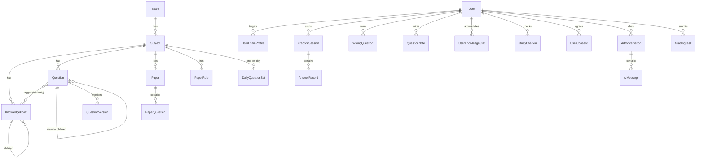
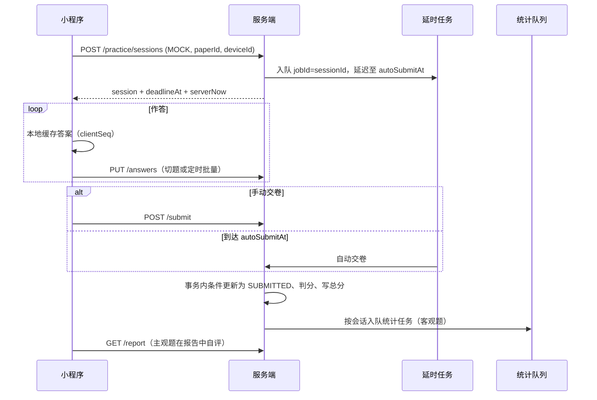
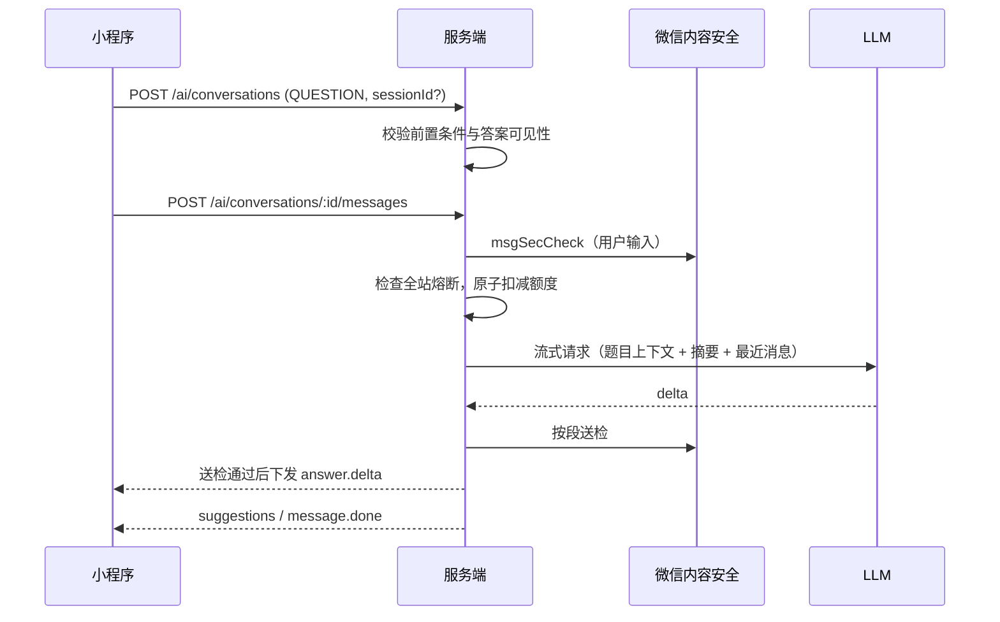

# 备考刷题小程序业务设计

## 1. 产品概述

### 1.1 定位

面向个人用户的备考学习小程序，以「题库刷题 + AI 辅导」为核心，覆盖高校考试与社会类考试。

| 人群     | 典型考试                                 |
| -------- | ---------------------------------------- |
| 高校学生 | 四六级、考研公共课、计算机二级、期末复习 |
| 社会考生 | 国考/省考（行测、申论）、事业编、教资    |

两类人群共用同一套「考试 → 科目 → 知识点」内容模型，差异只体现在内容数据上。首个上线的考试与科目为**国考 · 行测**（客观题为主，资料分析为材料题），申论随 P1 AI 批改上线。听力通过「材料题挂音频」支持；计算机二级的上机操作题不在覆盖范围内。

### 1.2 核心闭环

```text
选择目标考试 → 刷题/模考 → 自动判分与解析 → 错题沉淀 → 薄弱点分析 → 针对性练习
                    ↘ AI 讲题 / AI 批改主观题 ↗
```

### 1.3 平台与合规约束

| 约束                   | 影响与处理                                                                 |
| ---------------------- | -------------------------------------------------------------------------- |
| 个人主体可选类目有限   | 按工具类上线，不含直播、web-view、人脸核身                                 |
| 个人主体不可接微信支付 | 会员付费放在 P2，需先升级为个体工商户或企业主体                            |
| iOS 虚拟商品支付限制   | 会员售卖需走微信虚拟支付，现有 JSAPI 支付链路不一定可复用                  |
| 生成式 AI 服务备案     | 只接入境内已完成备案的大模型；提审前确认平台对 AI 功能的资质要求，不满足时 AI 功能整体通过远程配置关闭 |
| AI 生成内容标识与举报  | AI 输出处标注「内容由 AI 生成」，首次使用 AI 前须同意 AI 服务声明并留存记录；每条 AI 消息提供投诉举报入口 |
| 内容安全               | 文本走 `msgSecCheck`（需用户 openid），图片走 `mediaCheckAsync`（异步回调）；无 openid 的用户须绑定微信后才能使用 AI 功能 |
| 订阅消息               | 个人主体仅可用一次性订阅模板，每次授权只能下发一条                         |
| 题目版权               | 题目来源限于自编、可公开使用、AI 生成后人工校对                            |
| 个人信息               | 隐私政策须说明作答数据、手写照片、AI 对话的用途与第三方模型处理；同意记录留存；账号注销后清理学习数据（4.12） |

### 1.4 分期

| 阶段 | 范围                                                                                         |
| ---- | -------------------------------------------------------------------------------------------- |
| P0   | 目标考试、题库刷题、错题本、收藏与笔记、模拟考试（主观题自评不计分）、学习统计与打卡、AI 讲题、题目纠错与勘误、隐私合规与注销清理、运营后台与题目导入、监控告警、接口限流与 AI 成本熔断 |
| P1   | AI 助教自由对话、AI 批改主观题（回填试卷分数）、AI 错题分析、学情报告与预测分、AI 出题、收藏题练习、学习计划、真题年份筛选、题库搜题、错题导出 PDF、成绩与打卡分享海报、学习提醒订阅消息、纠错处理结果通知、数据埋点与运营看板、答题偏好设置 |
| P2   | 会员与付费题库、游戏化成长、学习小组、全站定时模考与排行、词汇背诵、题目修订审计、个人数据导出、离线题包 |

---

## 2. 角色与权限

| 角色   | 来源                  | 能力                                                         |
| ------ | --------------------- | ------------------------------------------------------------ |
| 游客   | 未登录                | 浏览考试分类、知识点目录、试卷列表；试做当日每日一练前 3 题（服务端判分，不落库） |
| 用户   | `RoleEnum.user`       | 全部学习功能，AI 功能受额度限制且须绑定微信、同意 AI 服务声明 |
| 会员   | 用户 + 有效会员（P2） | 付费题库、更高 AI 额度                                       |
| 管理员 | `RoleEnum.admin`      | 内容管理、审核、勘误、纠错处理、AI 出题、配置与数据查看      |

新增权限：

| 权限             | 授予  | 说明                                       |
| ---------------- | ----- | ------------------------------------------ |
| `practice:write` | user  | 创建练习、提交作答                         |
| `ai:chat`        | user  | AI 对话与讲题                              |
| `ai:grading`     | user  | 提交 AI 批改                               |
| `content:manage` | admin | 考试、科目、知识点、题目、试卷、组卷规则、导入 |
| `content:review` | admin | 题目审核、发布、下架、勘误、纠错处理       |
| `ai:generate`    | admin | AI 批量出题                                |
| `ai:admin`       | admin | AI 用量与成本查询                          |

落地要求：

1. 权限以数据库 `role_permission` 表为准（`PermissionsService` 带缓存），新增权限须同时写 migration/seed 授权、同步 `src/core/permissions/role-permissions.ts` 静态映射，上线后清理权限缓存。
2. admin 拥有全部权限，单人运营，编辑与审核不做分离。
3. 会员资格不走 RBAC，由业务层根据 `UserMembership` 判断。
4. 「公开、登录后附带个人数据」的接口使用新增的可选鉴权 guard：带合法 token 时解析用户，否则按游客处理。

---

## 3. 领域模型总览



模块划分（`src/modules/` 下新增）：

| 模块          | 职责                                           | 阶段  |
| ------------- | ---------------------------------------------- | ----- |
| `exams`       | 考试、科目、知识点树、用户目标考试             | P0    |
| `questions`   | 题目、版本、材料题、笔记、纠错、勘误、导入     | P0    |
| `papers`      | 试卷、组卷规则、每日一练题组                   | P0    |
| `practice`    | 练习会话、作答、判分、交卷                     | P0    |
| `wrong-book`  | 错题本                                         | P0    |
| `study-stats` | 知识点掌握度、学习统计、打卡、学情报告         | P0/P1 |
| `ai`          | AI 对话、讲题、批改、出题、额度与成本          | P0/P1 |
| `compliance`  | 协议同意记录、账号注销清理                     | P0    |
| `membership`  | 会员套餐、会员资格                             | P2    |

外部集成新增 `src/integrations/llm`：定义 `LlmProvider` 端口（流式对话、结构化输出、图片理解），默认实现接入境内已备案模型，具体模型与 ID 走配置（见第 8 节）。

运营后台为独立前端，调用本文 `/admin/*` 接口（4.11）。

---

## 4. 模块设计

通用约定：

- 主键：新实体使用 UUID（题目等对外资源不可遍历）；`userId` 沿用现有用户表的数字 ID。所有实体含 `createdAt`、`updatedAt`。
- 时区：所有「按天」的口径（统计日、打卡、每日一练、AI 额度、近 N 天）统一按 `Asia/Shanghai` 计算。
- 分数：`numeric(6,2)`，保留两位小数。
- 并发写入的计数字段一律使用 SQL 原子自增，不做读改写。
- 异步任务全部基于 BullMQ，生产环境必须开启 Redis。

### 4.1 考试与知识点（exams）

#### 实体

**Exam**

| 字段        | 类型    | 说明                                                                                                    |
| ----------- | ------- | ------------------------------------------------------------------------------------------------------- |
| id          | uuid    |                                                                                                         |
| name        | string  | 如「国考」「英语四级」                                                                                  |
| category    | enum    | `CIVIL_SERVICE` / `PUBLIC_INSTITUTION` / `TEACHER` / `COLLEGE_ENGLISH` / `POSTGRADUATE` / `COMPUTER` / `OTHER` |
| icon        | string? |                                                                                                         |
| description | string? |                                                                                                         |
| sort        | number  |                                                                                                         |
| status      | enum    | `DRAFT` / `PUBLISHED` / `OFFLINE`                                                                       |

**Subject**：`id`、`examId`、`name`、`sort`、`status`（同上）、`hasSubjective`、`defaultRubricId?`（P1）。

**KnowledgePoint**：`id`、`subjectId`、`parentId`、`name`、`level`、`sort`、`path`（物化路径）、`isLeaf`、`questionCount`（已发布题目数）。

**UserExamProfile**

| 字段      | 类型    | 说明                                    |
| --------- | ------- | --------------------------------------- |
| userId    | number  |                                         |
| examId    | uuid    |                                         |
| isCurrent | boolean | 部分唯一索引 `(userId) WHERE isCurrent` |
| examDate  | date?   | 考试日期，首页倒计时                    |
| dailyGoal | number  | 每日目标题数，默认 30                   |

唯一键 `(userId, examId)`。

#### 业务规则

1. 首次登录未设置目标考试时引导进入选考试页；游客的选择存本地，登录后同步。
2. 首个关注的考试自动设为当前；切换当前考试在事务内完成；取消关注当前考试时，最近关注的另一个考试成为当前，没有则为空。
3. 知识点树最多三级；题目只能关联叶子节点。已关联题目的节点不允许新增子节点，须先把题目迁移到其他叶子节点。
4. `questionCount` 在题目发布、下架、修改知识点标签时于同一事务内增减，并提供全量重算脚本。
5. 删除知识点前必须无子节点且无关联题目；下架考试或科目后历史记录保留，入口不再展示。

#### 接口

| 方法   | 路径                                | 权限     | 说明                         |
| ------ | ----------------------------------- | -------- | ---------------------------- |
| GET    | `/exams`                            | 公开     | 考试列表（按 category 分组） |
| GET    | `/exams/:id/subjects`               | 公开     | 科目列表                     |
| GET    | `/subjects/:id/knowledge-points`    | 可选登录 | 知识点树，登录时附带个人进度 |
| GET    | `/me/exam-profiles`                 | 登录     | 我的目标考试                 |
| PUT    | `/me/exam-profiles/:examId`         | 登录     | 关注/更新考试日期与每日目标  |
| POST   | `/me/exam-profiles/:examId/current` | 登录     | 设为当前考试                 |
| DELETE | `/me/exam-profiles/:examId`         | 登录     | 取消关注                     |

管理端接口见 4.11。

### 4.2 题目（questions）

#### 实体

**Question**

| 字段              | 类型     | 说明                                                         |
| ----------------- | -------- | ------------------------------------------------------------ |
| id                | uuid     |                                                              |
| subjectId         | uuid     |                                                              |
| type              | enum     | 见题型表                                                     |
| currentVersion    | number   | 当前生效版本号，首次发布时为 1                               |
| stem              | text     | 当前版本题干，Markdown + LaTeX（`$...$`）；图片以 `file:{fileId}` 占位，接口输出时解析为可访问地址 |
| options           | json?    | `[{ key: 'A', content: string }]`                            |
| answer            | json     | 结构随题型变化                                               |
| analysis          | text?    | 解析，Markdown                                               |
| difficulty        | 1-5      |                                                              |
| knowledgePointIds | uuid[]   | 关联表 `question_knowledge_point`，仅叶子节点                |
| parentId          | uuid?    | 材料题小题指向材料                                           |
| material          | text?    | 仅 `MATERIAL` 使用                                           |
| audioFileId       | string?  | 仅 `MATERIAL` 使用，听力音频                                 |
| source            | enum     | `ORIGINAL` / `PUBLIC` / `AI_GENERATED`                       |
| sourceNote        | string?  | 如「2025 年模拟卷」                                          |
| status            | enum     | `DRAFT` / `REVIEWING` / `PUBLISHED` / `OFFLINE`              |
| isFree            | boolean  | false 时仅会员可做（P2）                                     |
| contentHash       | string   | 去重哈希：独立题 = 题干 + 选项；小题 = 材料哈希 + 题干 + 选项 |
| statAnswered      | number   | 全站首次作答人次                                             |
| statCorrect       | number   | 全站首次作答正确人次                                         |

**QuestionVersion**：`questionId`、`version`、`type`、`stem`、`options`、`answer`、`analysis`、`material`、`audioFileId`、`knowledgePointIds`、`materialVersion`（小题快照对应的材料版本，材料与独立题为空）、`changeType`（`PUBLISH` / `EDIT` / `ERRATA`）、`createdAt`；唯一键 `(questionId, version)`。

- 首次发布写入 v1（`PUBLISH`）；发布前的 `DRAFT` 修改不产生版本。
- 发布后每次修改生成新版本；渲染按引用方记录的版本读取 `QuestionVersion`。
- `EDIT` 不允许修改 `answer`、`type`、选项 key 集合与填空空数；修改答案只能走勘误（`ERRATA`）。
- 判分统一读取题目最新版本的 `answer`（答案只会经勘误变化），作答记录的 `questionVersion` 仅记录作答时看到的题面版本。

**题型与答案结构**

| type           | 名称      | 题目 answer                                     | 用户 answer                  | 判分方式            |
| -------------- | --------- | ----------------------------------------------- | ---------------------------- | ------------------- |
| `SINGLE`       | 单选      | `{ keys: ['B'] }`                               | `{ keys: ['B'] }`            | 完全一致            |
| `MULTIPLE`     | 多选      | `{ keys: ['A','C'] }`                           | `{ keys: [...] }`            | 见 4.4 判分         |
| `JUDGE`        | 判断      | `{ value: true }`                               | `{ value: boolean }`         | 完全一致            |
| `FILL`         | 填空      | `{ blanks: [['答案1','同义答案'], ['答案2']] }` | `{ blanks: ['...', '...'] }` | 逐空匹配候选值      |
| `SHORT_ANSWER` | 简答      | `{ reference, points: string[], rubricId? }`    | `{ text?, imageFileIds? }`   | 自评；P1 可 AI 批改 |
| `ESSAY`        | 作文/申论 | `{ reference?, rubricId? }`                     | `{ text?, imageFileIds? }`   | 自评；P1 可 AI 批改 |
| `MATERIAL`     | 材料题    | 无，作为小题容器                                | 无                           | 按小题分别判分      |

填空归一化：去首尾空白、全角转半角、英文忽略大小写、数字去千分位。主观题未指定 `rubricId` 时使用科目 `defaultRubricId`。`imageFileIds` 只能引用本人上传的文件。

**QuestionNote**：`userId`、`questionId`、`content`（≤ 1000 字）；唯一键 `(userId, questionId)`。

**题目纠错**（复用 feedbacks 模块）：`FeedbackType` 新增 `question_error`；Feedback 新增 `questionId?`、`questionVersion?`、`reason?`（`answer_wrong` / `analysis_wrong` / `stem_typo` / `other`）、`errataId?`；处理回复使用现有 `reply` 字段，状态沿用 `FeedbackStatus`。

**Errata**（勘误任务）：`id`、`questionId`、`toVersion`、`status`（`PENDING` / `RUNNING` / `DONE` / `FAILED`）、`affectedUsers`、`processedUsers`、`createdBy`。部分唯一索引 `(questionId) WHERE status IN ('PENDING','RUNNING')`，同一题同一时间只能有一个未完成的勘误。

#### 业务规则

1. 状态流转：`DRAFT → REVIEWING → PUBLISHED ⇄ OFFLINE`，`REVIEWING` 可驳回为 `DRAFT`。只有 `PUBLISHED` 被抽入新会话。材料题的材料与其全部小题作为一个整体流转（提交、驳回、发布、下架同时进行），小题不能单独变更状态，`isFree` 跟随材料。
2. 已被作答过的题目不可物理删除，只能下架。
3. 新建或导入时按 `contentHash` 查重，重复则拒绝或提示合并。
4. **题目访问**：用户不能按 ID 任意拉取题目。题目内容只通过会话分段接口、错题本、收藏、笔记列表返回；单题接口校验用户与该题的关联。`PracticeSession.questionIds` 建 GIN 索引支撑关联查询。
5. **建立关联的前提**：收藏、写笔记要求该题在用户的某个会话中已满足答案可见性规则 1-3（4.4），且满足 `isFree` 限制。进行中或已放弃的 `MOCK` 中的题不能因此建立关联。
6. **答案与解析可见性**：见 4.4「答案可见性」。
7. 材料题以材料为单位出题，小题顺序固定，小题挂知识点。
8. **下架题**：已在进行中会话或已发布试卷中的下架题仍可作答与判分；错题本、收藏中展示「已下架」，不再被抽入新会话。
9. **勘误**：管理员确认答案错误后执行勘误（可关联纠错单），基于当前版本只修改答案与解析，生成 `ERRATA` 新版本并创建 Errata 任务。由于判分始终读取最新答案，勘误生效后的新判分自动正确，任务只需修正已判分的历史数据：
   1. 同步更新引用：已发布试卷的 `PaperQuestion.questionVersion` 与 `IN_PROGRESS` 会话的 `questionVersions` 更新为 `toVersion`（试卷版本冻结的唯一例外）。因 `EDIT` 不能改题型、选项 key 与空数，跳版只会带入文字类修改。
   2. 异步重判：该题所有版本小于 `toVersion` 且已判分的**客观题**作答记录按新答案重判，更新 `isCorrect`、`isPartial`、`score`、`questionVersion`，并重算所属会话的 `score`、`correctCount`；主观题记录只更新 `questionVersion`。
   3. 统计修正：对 `isCorrect` 发生变化且已计入统计（`statsAppliedAt` 非空）的记录，按用户在 `stats:user:{userId}` 锁与同一事务内执行：
      - 知识点统计：该用户在该题叶子知识点上的 `UserKnowledgeStat` 由已计入的作答记录全量重建（含 `recentResults`）。
      - 每日统计：按记录的 `statDate` 对 `UserDailyStat.correct` 做 ±1。
      - 错题本：判错记录指该用户该题已计入且 `isCorrect = false` 的作答记录（含部分正确与自评 `UNKNOWN`）。由判错记录重算 `wrongCount`、`lastWrongAnswer`、`firstWrongAt`；不存在判错记录时删除错题记录；存在判错记录但无错题记录时新建为 `ACTIVE`，`firstWrongAt` 取最早判错记录的 `gradedAt`；其余情况 `status` 与 `consecutiveCorrect` 不变。
      - 全站统计：`firstForQuestion = true` 的记录对 `statCorrect` 做 ±1（增量修正，不全量重算，保留已注销用户的贡献）。
   4. 完成后向受影响用户发站内通知，关联的纠错单置为 `resolved` 并写入回复。
10. 题目收藏复用 favorites 模块（第 6 节）。

#### 接口

| 方法   | 路径                         | 权限 | 说明                                     |
| ------ | ---------------------------- | ---- | ---------------------------------------- |
| GET    | `/questions/:id`             | 登录 | 题目内容；需与用户存在关联               |
| PUT    | `/questions/:id/note`        | 登录 | 保存笔记                                 |
| DELETE | `/questions/:id/note`        | 登录 | 删除笔记                                 |
| GET    | `/me/question-notes`         | 登录 | 我的笔记列表                             |
| POST   | `/questions/:id/reports`     | 登录 | 题目纠错                                 |
| GET    | `/me/question-reports`       | 登录 | 我的纠错记录与处理结果                   |
| GET    | `/questions/search?keyword=` | 登录 | 搜题（P1）：返回题干摘要，不含答案；查看详情以背题会话打开 |

题目相关接口按用户限流。管理端接口见 4.11。

### 4.3 试卷（papers）

#### 实体

**Paper**

| 字段             | 类型    | 说明                                                       |
| ---------------- | ------- | ---------------------------------------------------------- |
| id               | uuid    |                                                            |
| subjectId        | uuid    |                                                            |
| title            | string  |                                                            |
| type             | enum    | `REAL`（真题）/ `MOCK`（模拟卷）/ `SPECIAL`（专项卷）/ `GENERATED`（按规则生成） |
| year             | number? | 真题年份                                                   |
| ownerUserId      | number? | `GENERATED` 必填，仅本人可见                               |
| durationMin      | number  | 考试时长                                                   |
| sections         | json    | `[{ title, questionType }]`，仅用于分区展示                |
| totalScore       | number  | 冗余，等于全部 `PaperQuestion.score` 之和                  |
| objectiveScore   | number  | 冗余，客观题分值之和                                       |
| multiScoringRule | enum    | `ALL_OR_NOTHING` / `PARTIAL`                               |
| status           | enum    | `DRAFT` / `PUBLISHED` / `OFFLINE`                          |
| isFree           | boolean |                                                            |
| attemptCount     | number  | 累计参考人数（首次作答人数），原子自增，不因注销减少；对外展示的「参考人数」 |

**PaperQuestion**：`paperId`、`sectionIndex`、`questionId`、`questionVersion`、`sort`、`score`。分值唯一来源是 `PaperQuestion.score`；材料题按小题各自记分。

**PaperRule**（随机组卷模板）：`subjectId`、`name`、`durationMin`、`multiScoringRule`、`items: [{ sectionTitle, questionType, knowledgePointIds?, difficultyRange?, count, scorePerQuestion }]`、`status`。

**DailyQuestionSet**：`subjectId`、`date`、`questionIds`；唯一键 `(subjectId, date)`。每天 00:05 按科目生成一组（默认 10 题，全站相同），未生成时首次访问兜底生成。

#### 业务规则

1. 已发布试卷的题目列表与 `questionVersion` 冻结（勘误除外，见 4.2）；修改需复制为新试卷。
2. **按规则生成**：用户调用生成接口，按 `PaperRule` 抽题（优先排除近 30 天做过的题，题量不足时放宽），创建 `type = GENERATED`、`status = PUBLISHED`、`ownerUserId` 为本人的试卷，`sections` 按 `items` 的 `sectionTitle` 生成，`questionVersion` 取各题 `currentVersion`，返回 `paperId`；随后由客户端以 `MOCK` 模式开考。每用户每日生成次数受远程配置限制；7 天内未开考的 `GENERATED` 试卷由定时任务删除。
3. 公开的试卷接口过滤非本人的 `GENERATED` 试卷。
4. **成绩口径**：
   - 首次作答：用户在该试卷上首次写入非空答案的会话标记 `isFirstAttempt = true`（写入时机见 4.4），即使之后被放弃或清空答案也占用首次，重考不再成为首次。
   - 「超过多少用户」只取 `isFirstAttempt = true` 且 `SUBMITTED` 的会话，并且只在相同 `scoringScheme` 内比较（4.4）；对外展示的参考人数取 `attemptCount`。`GENERATED` 试卷不展示。
   - P1 中 `pendingGrading = true` 的会话，以及 `FULL` 口径下存在未批改成功主观题的会话，不进入分位样本，报告标注「暂定」。
   - 分位查询索引：`(paperId, scoringScheme, isFirstAttempt, status, score)`。
5. 列表展示用户最近一次成绩与最高分。
6. `DailyQuestionSet` 当日已有用户会话时不允许重新生成。

#### 接口

| 方法 | 路径                              | 权限     | 说明                                   |
| ---- | --------------------------------- | -------- | -------------------------------------- |
| GET  | `/subjects/:id/papers`            | 可选登录 | 试卷列表（按 type 筛选；按 year 筛选为 P1），登录时附带个人成绩 |
| GET  | `/papers/:id`                     | 可选登录 | 试卷概要（时长、题量、分区）           |
| GET  | `/subjects/:id/paper-rules`       | 登录     | 可用组卷模板                           |
| POST | `/paper-rules/:id/generate`       | 登录     | 按模板生成个人试卷，返回 `paperId`     |
| GET  | `/subjects/:id/daily`             | 可选登录 | 当日每日一练概要，登录时附带完成情况   |
| GET  | `/subjects/:id/daily/trial`       | 公开     | 游客试做：前 3 题（不含答案），遇材料题以完整材料为单位 |
| POST | `/subjects/:id/daily/trial/check` | 公开     | 游客试做判分（不落库，按 IP 限流）     |

管理端接口见 4.11。

### 4.4 练习与考试（practice）

所有做题行为统一抽象为「练习会话」，模考是带计时与交卷约束的一种模式。

#### 实体

**PracticeSession**

| 字段             | 类型    | 说明                                                         |
| ---------------- | ------- | ------------------------------------------------------------ |
| id               | uuid    |                                                              |
| userId           | number  |                                                              |
| subjectId        | uuid    |                                                              |
| mode             | enum    | 见模式表                                                     |
| paperId          | uuid?   | `MOCK` 必填                                                  |
| dailyDate        | date?   | `DAILY` 必填                                                 |
| scope            | json    | `{ knowledgePointId?, questionType?, fromSessionId? }`       |
| questionIds      | uuid[]  | 出题快照（小题 ID），同一材料的小题连续                      |
| questionVersions | json    | `{ [questionId]: version }`；`MOCK` 取 `PaperQuestion.questionVersion`，其他模式取 `currentVersion` |
| status           | enum    | `IN_PROGRESS` / `SUBMITTED` / `ABANDONED`                    |
| activeDeviceId   | string? | 限时模式当前作答设备                                         |
| startedAt        | date    |                                                              |
| deadlineAt       | date?   | 限时模式：`startedAt + durationMin`                          |
| autoSubmitAt     | date?   | 限时模式：`deadlineAt + 离线补交窗口`（远程配置，默认 5 分钟） |
| submittedAt      | date?   |                                                              |
| submitType       | enum?   | `MANUAL` / `AUTO_TIMEOUT`                                    |
| lastActiveAt     | date    | 最近一次作答或进度上报                                       |
| isFirstAttempt   | boolean | 见 4.3                                                       |
| scoringScheme    | enum?   | `OBJECTIVE_ONLY`（P0）/ `FULL`（P1 起含主观题）；仅 `MOCK`   |
| score            | number? | 仅 `MOCK`                                                    |
| totalScore       | number? | 仅 `MOCK`；`OBJECTIVE_ONLY` 时为 `objectiveScore`            |
| correctCount     | number  | `isCorrect = true` 的作答数，含主观题自评与批改结果，原子增减 |
| answeredCount    | number  | `answer` 非空的作答数，原子增减                              |
| durationSec      | number  | 见作答规则                                                   |
| lastIndex        | number  | 最近浏览位置                                                 |
| pendingGrading   | boolean | 存在未结束的 AI 批改任务时为 true（P1）                      |

索引：

- 限时会话唯一：`(userId, paperId) WHERE status = 'IN_PROGRESS' AND mode = 'MOCK'`
- 首次作答唯一：`(userId, paperId) WHERE isFirstAttempt`
- 每日一练唯一：`(userId, subjectId, dailyDate) WHERE mode = 'DAILY'`
- 题目关联：`questionIds` GIN 索引
- 兜底扫描：`(status, autoSubmitAt)`；过期清理：`(status, lastActiveAt)`
- 分位：见 4.3

**练习模式**

| mode       | 名称     | 出题方式                                                     | 计时 |
| ---------- | -------- | ------------------------------------------------------------ | ---- |
| `CHAPTER`  | 章节练习 | 知识点子树内，未做过的优先，默认 10 题                       | 否   |
| `RANDOM`   | 随机练习 | 科目内随机                                                   | 否   |
| `TYPE`     | 题型专项 | 按题型随机                                                   | 否   |
| `SMART`    | 智能练习 | 薄弱知识点 60% + 错题 20% + 未做题 20%，某类不足时由未做题补齐 | 否   |
| `DAILY`    | 每日一练 | 当日 `DailyQuestionSet`                                      | 否   |
| `WRONG`    | 错题重做 | 错题本 `ACTIVE` 题目，或 `fromSessionId` 指定会话中的错题    | 否   |
| `FAVORITE` | 收藏练习 | 收藏的题目（P1）                                             | 否   |
| `MOCK`     | 模拟考试 | 试卷全部题目                                                 | 是   |
| `MEMORIZE` | 背题模式 | 知识点或题型范围，直接展示答案解析，不产生作答与统计         | 否   |

除 `MOCK`、`MEMORIZE` 外均为「答完即判」模式。

**AnswerRecord**

| 字段             | 类型     | 说明                                                  |
| ---------------- | -------- | ----------------------------------------------------- |
| id               | uuid     |                                                       |
| sessionId        | uuid     |                                                       |
| userId           | number   |                                                       |
| questionId       | uuid     |                                                       |
| questionVersion  | number   | 作答时的题面版本                                      |
| answer           | json?    | 用户答案；为空表示已清空或仅标记                      |
| isCorrect        | boolean? | 未判分为 null                                         |
| isPartial        | boolean  | 多选部分得分                                          |
| score            | number?  | 仅 `MOCK`                                             |
| selfAssessment   | enum?    | 主观题自评：`KNOWN` / `UNKNOWN`                       |
| gradingStatus    | enum?    | `PENDING` / `DONE` / `FAILED`（P1）                   |
| gradingTaskId    | uuid?    |                                                       |
| durationSec      | number   | 单题用时，上限 600 秒                                 |
| markedForReview  | boolean  | 答题卡标记                                            |
| deviceId         | string   | 最近一次写入的设备                                    |
| clientSeq        | number   | 设备内递增序号                                        |
| clientAnsweredAt | date     | 客户端作答时间（按 `serverNow` 校准）                 |
| answeredAt       | date     | 服务端接收时间                                        |
| gradedAt         | date?    | 判分时间（含自评、批改回填）                          |
| statDate         | date?    | 计入统计的日期                                        |
| statsAppliedAt   | date?    | 已计入错题本与统计的时间                              |
| firstForQuestion | boolean  | 是否为该用户对该题首次计入统计的作答                  |

唯一键 `(sessionId, questionId)`；部分唯一索引 `(userId, questionId) WHERE firstForQuestion`；索引 `(userId, questionId)`、`(questionId, gradedAt)`；补偿扫描部分索引 `(gradedAt) WHERE statsAppliedAt IS NULL AND isCorrect IS NOT NULL`。

#### 答案可见性

**前提**：该题不在用户任何 `IN_PROGRESS` 的 `MOCK` 会话中。不满足前提时：

- 任何接口都不返回该题的答案、解析、参考答案与判分结果，题目内容接口附带 `hiddenReason = mockInProgress`。
- 非 `MOCK` 会话对该题的作答写入一律拒绝，返回 `questionInMockInProgress`（含已存在的会话与每日一练）。

满足前提后，服务端只在以下情况返回答案与解析：

1. 会话为 `MEMORIZE`。
2. 「答完即判」会话中：客观题已判分；主观题已提交作答（返回参考答案与 `points` 供自评）。
3. `MOCK` 会话已 `SUBMITTED`。
4. 题目在用户的错题本、收藏或笔记中。

补充：

- 创建非限时会话时，抽题排除用户 `IN_PROGRESS` 的 `MOCK` 会话中的题目。
- `MEMORIZE` 的 scope 不接受试卷，且遵守 `isFree`。
- 「问 AI」使用同一判定（4.7）。

#### 业务规则

**创建**

1. `MOCK` 按 `(userId, paperId)` 唯一：以 `INSERT ... ON CONFLICT DO NOTHING` 创建，未插入时再查询返回已有会话（断点续考）；「重新开始」需先放弃原会话。
2. `DAILY` 每用户每科目每天一个会话，重复进入返回同一会话；`DAILY` 没有「结束练习」、不可放弃、不参与过期清理，始终为 `IN_PROGRESS`，跨天后仍可继续作答，但不再计入当天打卡。
3. 其他非限时会话允许并存，首页「继续练习」展示最近一个未完成会话；`lastActiveAt` 超过 7 天的非限时会话（不含 `DAILY`）由定时任务置为 `ABANDONED`。
4. 出题排除 `OFFLINE` 题目（`MOCK` 除外）；非会员排除 `isFree = false` 的题目（P2）。
5. 出题与 `count` 均以小题计；随机类模式以材料为单位抽取，保证同一材料的小题完整连续。
6. 可出题数为 0 时拒绝创建；不足 `count` 时按实际题数创建并返回 `insufficient: true`。

**作答**

1. 「答完即判」模式：
   - 客观题首次保存即判分并锁定，响应返回 `isCorrect`、正确答案与解析；再次提交返回原结果。
   - 主观题首次保存只落库并锁定答案，响应返回参考答案与 `points`；用户随后提交自评，自评后锁定。
2. `MOCK` 模式：保存只落库不判分，允许覆盖。写入来自记录上同一 `deviceId` 时，`clientSeq` 不大于已存值的写入忽略；来自新的活动设备时直接覆盖。提交空答案表示清空：`answer` 置空并保留记录与 `clientSeq`，`answeredCount` 减 1。
3. 非 `MOCK` 模式的空答案视为未作答，不判分；仅「标记」时以 `answer` 为空的记录保存 `markedForReview`。
4. **单设备作答**：`MOCK` 会话同一时间只允许一个设备作答。只有创建/续考接口（`POST /practice/sessions`）携带新的 `deviceId` 时才接管（更新 `activeDeviceId`），查询类接口不接管；`deadlineAt` 之后禁止接管。原设备下次写入返回 `sessionTakenOver`。
5. **首次作答标记**：`MOCK` 会话写入第一条非空答案时，在同一事务内检查该用户在该试卷上是否已有 `isFirstAttempt` 会话，没有则置 `isFirstAttempt = true` 并原子自增 `Paper.attemptCount`；并发由部分唯一索引兜底。之后清空答案不回退。
6. **限时写入窗口**（作答写入接口）：
   - `deadlineAt` 之前：正常接受。
   - `deadlineAt` 至 `autoSubmitAt`：只接受当前设备 `offline = true` 且 `clientAnsweredAt ≤ deadlineAt` 的批量补交。客户端在 `deadlineAt` 本地锁定答题。该规则只能缓解、不能杜绝篡改本地时间的作弊。
   - `autoSubmitAt` 之后或会话非 `IN_PROGRESS`：拒绝，返回 `sessionClosed`。
7. 写入在同一事务内先 `SELECT ... FOR SHARE` 会话行并校验状态，与交卷互斥。
8. 客户端倒计时以接口返回的 `serverNow` 与 `deadlineAt` 校准。
9. 未同步的作答按会话 ID 缓存在本地，重连后通过批量接口补交。
10. **自评可用状态**：`MOCK` 会话为 `SUBMITTED`；其他模式为非 `ABANDONED`。自评后锁定；P1 中存在未结束批改任务的题不可自评。
11. `durationSec`：`MOCK` 为 `min(submittedAt, deadlineAt) - startedAt`；其他模式为各题 `durationSec` 之和（单题已截断）。

**判分**

| 题型            | 规则                                                                                       |
| --------------- | ------------------------------------------------------------------------------------------ |
| 单选/判断       | 一致得满分，否则 0 分                                                                      |
| 多选            | `ALL_OR_NOTHING`：完全一致得分；`PARTIAL`：无错选且少选得一半（`isPartial = true`，`isCorrect = false`），有错选 0 分；非 `MOCK` 模式按 `ALL_OR_NOTHING` 判定对错 |
| 填空            | 每空分值 = 题目分值 / 空数，保留两位小数，末空补齐差额；全部正确才 `isCorrect = true`       |
| 简答/作文（P0） | 自评：`KNOWN` → `isCorrect = true`，`UNKNOWN` → `isCorrect = false`；`MOCK` 中不计分，交卷后在成绩报告中自评 |
| 简答/作文（P1） | `MOCK` 交卷后创建 AI 批改任务，批改期间不可自评；完成后 `score = round(批改总分 / 量表满分 × 题目分值, 2)`，得分率 ≥ 60% 时 `isCorrect = true`；批改失败时 `isCorrect` 保持 null，`score = 0`，用户可选择重试或改为自评，自评后不可再重试 |
| 材料题          | 按小题各自判分与计分                                                                       |

非 `MOCK` 模式不计 `score`，报告只展示正确率。

**交卷**

1. 手动交卷前，接口返回未作答题数供前端二次确认。
2. 交卷在一个事务内完成：条件更新 `UPDATE practice_session SET status = 'SUBMITTED' ... WHERE id = ? AND status = 'IN_PROGRESS'` → 判分全部客观题 → 写入 `score`、`correctCount`、`scoringScheme`。条件更新影响 0 行时直接返回当前结果。
3. `autoSubmitAt` 之后到达的手动交卷记为 `AUTO_TIMEOUT`。
4. 自动交卷：创建 `MOCK` 会话时入队 BullMQ 延时任务（`jobId = sessionId`，延迟到 `autoSubmitAt`）；另有每 5 分钟的兜底扫描任务，以 `LockService` 互斥，正确性由条件更新保证。`answeredCount = 0` 的超时会话置为 `ABANDONED`。
5. 「答完即判」模式（`DAILY` 除外）点「结束练习」只把状态置为 `SUBMITTED`。
6. 被放弃的 `MOCK` 会话不判分，其作答不计入错题本与统计。

**统计事件**

统计事件只处理 `isCorrect IS NOT NULL` 的作答记录，`statsAppliedAt` 只在真正计入时写入，保证每条记录只计入一次：

| 场景                   | 触发时机                           | `statDate`                 |
| ---------------------- | ---------------------------------- | -------------------------- |
| 答完即判客观题         | 首次判分后                         | 判分时间                   |
| 主观题自评             | 提交自评后                         | 自评时间                   |
| `MOCK` 客观题          | 交卷事务提交后按会话入队           | `submittedAt`              |
| `MOCK` 主观题（P1）    | 批改回填 `isCorrect` 后            | `submittedAt`              |
| `MEMORIZE`             | 不触发                             | —                          |

处理器在一个事务内完成：

1. `UPDATE answer_record SET statsAppliedAt = now() WHERE id = ? AND statsAppliedAt IS NULL AND isCorrect IS NOT NULL`，影响 0 行则跳过（幂等的唯一依据）。
2. 重读该记录（勘误可能已改变 `isCorrect`）。
3. 更新错题本（4.5）→ 更新知识点与每日统计（4.6）→ 判定打卡（4.6）。
4. 若该用户此前从未计入过该题，置 `firstForQuestion = true` 并累加题目全站统计；并发由部分唯一索引兜底，冲突时视为非首次。

入队与执行：

- 答完即判与自评按记录入队，`jobId = recordId`；`MOCK` 交卷按会话入队一个任务，任务内逐条处理。
- 处理前以 `LockService` 按 `stats:user:{userId}` 加锁以减少冲突，抢锁失败则延迟重试；正确性由上述事务与唯一索引保证，不依赖锁。勘误统计修正使用同一个锁 key。
- **补偿**：每 10 分钟扫描 `isCorrect IS NOT NULL AND statsAppliedAt IS NULL AND gradedAt < now - 10min` 的记录，以 `jobId = recordId` 重新入队。

**成绩报告**（交卷后）

- 总分（P0 为客观题得分）、正确率、用时、超过多少用户（规则见 4.3）
- 按题型、按知识点的正确率
- 答题卡：对 / 错 / 部分正确 / 未答 / 待自评 / 待批改 / 未评分
- 主观题自评入口
- 「本次错题重做」：以 `mode = WRONG`、`fromSessionId` 创建会话；单题「问 AI」

#### 接口

| 方法 | 路径                                           | 说明                                                     |
| ---- | ---------------------------------------------- | -------------------------------------------------------- |
| POST | `/practice/sessions`                           | 创建或续考：`mode`、`subjectId`、`paperId?`、`scope`、`count?`、`deviceId` |
| GET  | `/practice/sessions/:id`                       | 会话详情 + 答题卡 + `serverNow`                          |
| GET  | `/practice/sessions/:id/questions?from=&size=` | 分段拉取题目，分段边界对齐材料；按可见性规则附带答案     |
| PUT  | `/practice/sessions/:id/answers`               | 保存作答（单条或批量，含 `deviceId`、`clientSeq`、`clientAnsweredAt`、`offline`） |
| POST | `/practice/sessions/:id/self-assessment`       | 主观题自评                                               |
| POST | `/practice/sessions/:id/progress`              | 记录 `lastIndex`                                         |
| POST | `/practice/sessions/:id/submit`                | 交卷 / 结束练习                                          |
| POST | `/practice/sessions/:id/abandon`               | 放弃                                                     |
| GET  | `/practice/sessions/:id/report`                | 成绩报告                                                 |
| GET  | `/practice/sessions`                           | 练习历史（分页，可按模式筛选）                           |
| GET  | `/practice/sessions/ongoing`                   | 未完成会话                                               |

写操作需 `practice:write`，查询类登录即可。

### 4.5 错题本（wrong-book）

#### 实体

**WrongQuestion**

| 字段               | 类型    | 说明                                   |
| ------------------ | ------- | -------------------------------------- |
| userId             | number  |                                        |
| questionId         | uuid    |                                        |
| subjectId          | uuid    | 冗余，便于按科目筛选                   |
| wrongCount         | number  | 累计错误次数                           |
| consecutiveCorrect | number  | 进入当前 `ACTIVE` 状态后的连续答对次数 |
| lastCorrectDate    | date?   | 最近一次计入连续答对的统计日           |
| lastWrongAnswer    | json    | 最近一次错误答案                       |
| firstWrongAt       | date    | 首次进入错题本时间                     |
| lastWrongAt        | date    |                                        |
| status             | enum    | `ACTIVE` / `MASTERED`                  |
| masteredAt         | date?   |                                        |
| aiAnalysis         | text?   | AI 错因分析缓存（P1）                  |
| aiAnalysisVersion  | number? | 分析时的题目版本，版本变化后失效       |

唯一键 `(userId, questionId)`。

#### 业务规则

1. 统计事件中判错（含 `isPartial`、自评 `UNKNOWN`）→ upsert：`wrongCount + 1`、`consecutiveCorrect = 0`、`status = ACTIVE`。
2. `ACTIVE` 题目在统计事件中判对 → 仅当该记录的 `statDate` 晚于 `lastCorrectDate`（或后者为空）时，`consecutiveCorrect + 1` 并更新 `lastCorrectDate`；同一统计日多次答对只计一次，乱序到达的较早记录不计入。
3. `consecutiveCorrect` 达到阈值（远程配置 `wrongBook.masterThreshold`，默认 3）→ `MASTERED`。
4. 主观题自评 `KNOWN` 不计入连续答对，主观题只能手动移出。
5. 手动「移出」→ `MASTERED`；手动「恢复」→ `ACTIVE` 且 `consecutiveCorrect = 0`；勘误导致的移出为删除记录（4.2）。
6. 下架题保留在错题本中并标注「已下架」，不再被抽入 `WRONG` 会话。
7. 统计口径：错题总数为 `ACTIVE` 数量；「本周新增」按 `firstWrongAt`；「本周消灭」按当前 `MASTERED` 且 `masteredAt` 在本周的数量。

#### 接口

| 方法 | 路径                                  | 说明                                     |
| ---- | ------------------------------------- | ---------------------------------------- |
| GET  | `/wrong-book`                         | 列表（分页、按科目/知识点/次数/时间筛选） |
| GET  | `/wrong-book/summary`                 | 按科目/知识点聚合的数量                  |
| POST | `/wrong-book/:questionId/master`      | 手动移出                                 |
| POST | `/wrong-book/:questionId/restore`     | 恢复                                     |
| POST | `/wrong-book/:questionId/ai-analysis` | AI 错因分析（P1，有效缓存直接返回）      |
| POST | `/wrong-book/export`                  | 导出 PDF（P1，异步生成，返回文件）       |

错题重做通过 `POST /practice/sessions`（`mode = WRONG`）发起。

### 4.6 学习统计与学情（study-stats）

#### 实体

**UserKnowledgeStat**：`userId`、`knowledgePointId`（仅叶子）、`answered`、`correct`、`recentResults`（`smallint[]`，最近 20 次，1 对 0 错）、`lastAnsweredAt`；唯一键 `(userId, knowledgePointId)`。

**UserDailyStat**：`userId`、`date`、`subjectId`、`answered`、`correct`、`durationSec`；唯一键 `(userId, date, subjectId)`。`MOCK` 的 `durationSec` 按会话用时计入 `submittedAt` 当天，其他模式按单题用时累加。

**StudyCheckin**：`userId`、`date`、`reason`（`DAILY_DONE` / `GOAL_REACHED`）；唯一键 `(userId, date)`。

#### 计算规则

| 指标         | 规则                                                                                 |
| ------------ | ------------------------------------------------------------------------------------ |
| 统计日       | 取作答记录的 `statDate`（4.4 统计事件表）                                            |
| 叶子掌握度   | 最近 20 次正确率 × 0.7 + 累计正确率 × 0.3；作答不足 5 次显示「数据不足」             |
| 父节点掌握度 | 查询时以已计入的作答记录联表 `question_knowledge_point`，按作答记录去重后按同一公式计算，结果缓存 10 分钟 |
| 薄弱知识点   | 叶子节点作答 ≥ 5 次且掌握度 < 60%，按掌握度升序                                      |
| 打卡         | 由统计事件处理器判定，打卡日期取触发记录的 `statDate`，满足其一即写入：该日 `DAILY` 会话（`dailyDate = statDate`）的客观题均已判分、主观题均已作答；该日当前考试下各科目 `answered` 之和 ≥ `dailyGoal` |
| 连续天数     | 从今天（今天未打卡则从昨天）向前连续打卡的天数                                       |
| 预测分（P1） | 各知识点掌握度 × 该知识点分值权重估算                                                |

写入方式：`answered = answered + 1` 等原子更新；`recentResults` 用 `array_append` 后截取最近 20 位。

#### 学情报告（P1）

- 周报：做题数、正确率趋势、用时、打卡天数、新增/消灭错题
- 知识点雷达：一级知识点掌握度
- AI 学习建议：统计数据交给 LLM 生成可执行建议，按周缓存

#### 学习计划（P1）

依据 `examDate`、`dailyGoal` 与知识点掌握度倒排，每天生成「今日任务」：优先薄弱知识点、待复习错题、未覆盖知识点。

#### 接口

| 方法 | 路径                               | 说明                                          |
| ---- | ---------------------------------- | --------------------------------------------- |
| GET  | `/me/study/overview`               | 首页数据：今日进度、连续打卡、倒计时、累计做题 |
| GET  | `/me/study/daily?from=&to=`        | 每日统计                                      |
| GET  | `/me/study/knowledge?subjectId=`   | 知识点掌握度树                                |
| GET  | `/me/study/weak-points?subjectId=` | 薄弱知识点                                    |
| GET  | `/me/study/report/weekly`          | 周报（P1）                                    |
| GET  | `/me/study/plan/today`             | 今日学习计划（P1）                            |
| GET  | `/me/checkins?month=`              | 打卡日历                                      |

### 4.7 AI 助教（ai：对话与讲题）

P0 只开放题目讲题（`contextType = QUESTION`）；自由对话（`GENERAL`）、错因分析、学情建议为 P1。

#### 实体

**AiConversation**

| 字段                 | 类型    | 说明                                                 |
| -------------------- | ------- | ---------------------------------------------------- |
| id                   | uuid    |                                                      |
| userId               | number  |                                                      |
| title                | string  | 首轮问题截断                                         |
| contextType          | enum    | `QUESTION` / `GENERAL` / `WRONG_ANALYSIS` / `REPORT` |
| contextId            | string? | 题目 ID 等                                           |
| contextVersion       | number? | 题目版本                                             |
| summary              | text?   | 早期消息摘要                                         |
| summaryUpToMessageId | uuid?   |                                                      |

**AiMessage**

| 字段           | 类型   | 说明                                                    |
| -------------- | ------ | ------------------------------------------------------- |
| id             | uuid   |                                                         |
| conversationId | uuid   |                                                         |
| role           | enum   | `USER` / `ASSISTANT`                                    |
| content        | text   | Markdown                                                |
| reasoning      | text?  | 深度思考内容                                            |
| suggestions    | json?  | 推荐追问                                                |
| status         | enum   | `STREAMING` / `DONE` / `STOPPED` / `FAILED` / `BLOCKED` |
| feedback       | enum?  | `LIKE` / `DISLIKE`                                      |
| usage          | json?  | token 用量与估算成本                                    |
| quotaDate      | date?  | 扣减额度所属日期，退还时使用                            |

**额度与成本**

- 用户额度：Redis 计数 `ai:quota:{userId}:{date}:{kind}`，`kind` 为 `chat` / `grading`，TTL 48 小时，额度值走远程配置。
- 频控：每用户每分钟请求上限。
- 全站熔断：按日累计估算成本（Redis `ai:cost:{date}`），超过远程配置 `ai.dailyBudget` 时暂停全部 AI 请求并返回 `aiUnavailable`。
- 成本同时按日落库（`AiUsageDaily`：`date`、`model`、`kind`、`requests`、`failures`、`inputTokens`、`outputTokens`、`cost`；唯一键 `(date, model, kind)`，按请求 upsert 累加），供后台查询。

#### 业务规则

1. **讲题**：创建 `QUESTION` 会话时可携带 `sessionId`。服务端按 4.4「答案可见性」判定：带 `sessionId` 时要求该题属于该会话的 `questionIds` 并按该会话判断，不带时只能命中第 4 条（错题本、收藏、笔记）。不可见时拒绝。
2. **复用**：同一用户同一题同一版本复用会话，题目版本变化后新建。**每次发送消息**都重新执行完整的可见性判定（含前提），不可见时拒绝并返回 `answerHidden`；通过后按最新可见的作答记录重新构建系统提示词（题干、选项、正确答案、解析、用户答案）。
3. **上下文**：携带最近 10 轮消息，更早内容压缩为 `summary`。
4. **请求顺序**：校验前置条件 → `msgSecCheck`（用户输入）→ 检查全站熔断 → 原子扣减额度（`INCR` 后比较，超限回滚）→ 请求模型。输入被拦截返回 `BLOCKED`，不扣额度。
5. **流式输出**：SSE，小程序端以 `uni.request` + `enableChunked` 接收。

   | event             | data                  |
   | ----------------- | --------------------- |
   | `message.start`   | `{ messageId }`       |
   | `reasoning.delta` | `{ text }`            |
   | `answer.delta`    | `{ text }`            |
   | `suggestions`     | `{ items: string[] }` |
   | `message.done`    | `{ usage }`           |
   | `error`           | `{ code, message }`   |

   SSE 开始输出后发生的异常不经过全局异常过滤器，统一转为 `error` 事件。
6. **输出安全**：`answer` 与 `reasoning` 按段落（或每 200 字）缓冲，送检通过后才下发；命中时停止生成，已下发内容保留，追加提示语，消息记为 `BLOCKED`。
7. **生成与连接解耦**：客户端断开（如切后台）不中止生成，服务端继续生成并落库，客户端回到页面后按 `messageId` 拉取完整结果。
8. **停止生成**：调用停止接口，经 Redis pub/sub 广播 `messageId`，持有上游连接的实例取消请求，已生成内容以 `STOPPED` 保存。
9. **计费口径**：

   | 结果                 | 额度                            |
   | -------------------- | ------------------------------- |
   | `DONE`               | 扣                              |
   | `STOPPED`            | 扣                              |
   | 输入 `BLOCKED`       | 不扣                            |
   | 输出 `BLOCKED`       | 扣                              |
   | `FAILED`（上游错误） | 退还至 `quotaDate` 对应的额度   |

10. **异常清理**：`STREAMING` 超过 5 分钟的消息由定时任务置为 `FAILED` 并退还额度。
11. **范围限制**：系统提示词限定为学习辅导，拒绝与备考无关的请求。
12. **前置条件**：用户须绑定微信（有 openid）并已同意当前版本的 AI 服务声明（4.12）。
13. **投诉举报**：每条 AI 消息可举报，写入 feedbacks（`FeedbackType` 新增 `ai_content`，关联 `messageId`），在后台纠错单列表中一并处理。

#### 接口

| 方法   | 路径                             | 说明                                             |
| ------ | -------------------------------- | ------------------------------------------------ |
| POST   | `/ai/conversations`              | 创建会话（`contextType`、`contextId`、`sessionId?`） |
| GET    | `/ai/conversations`              | 历史会话（分页）                                 |
| GET    | `/ai/conversations/:id/messages` | 消息列表                                         |
| POST   | `/ai/conversations/:id/messages` | 发送消息，SSE 返回（`@SkipResponseTransform()`） |
| GET    | `/ai/messages/:id`               | 拉取单条消息（断线后恢复）                       |
| POST   | `/ai/messages/:id/stop`          | 停止生成                                         |
| POST   | `/ai/messages/:id/feedback`      | 点赞/点踩                                        |
| POST   | `/ai/messages/:id/report`        | 投诉举报                                         |
| DELETE | `/ai/conversations/:id`          | 删除会话                                         |
| GET    | `/ai/quota`                      | 今日剩余额度                                     |

### 4.8 AI 批改主观题（ai：grading，P1）

#### 实体

**GradingRubric**：`id`、`subjectId`、`name`（如「申论-归纳概括」「英语作文」）、`fullScore`、`criteria: [{ name, maxScore, description }]`、`prompt`、`status`。

**GradingTask**

| 字段           | 类型     | 说明                                                |
| -------------- | -------- | --------------------------------------------------- |
| id             | uuid     |                                                     |
| userId         | number   |                                                     |
| trigger        | enum     | `USER`（用户主动提交）/ `PAPER`（试卷交卷自动创建） |
| questionId     | uuid?    | 自由提交时为空                                      |
| answerRecordId | uuid?    | 试卷作答时关联                                      |
| rubricId       | uuid     |                                                     |
| content        | text?    | 文字作答                                            |
| imageFileIds   | string[] | 手写拍照（最多 6 张，仅限本人文件）                 |
| status         | enum     | `PENDING` / `CHECKING_MEDIA` / `PROCESSING` / `DONE` / `FAILED` |
| result         | json?    | 见下方                                              |
| failReason     | string?  |                                                     |
| quotaDate      | date?    | `USER` 任务扣减额度所属日期                         |

`result` 结构：

```json
{
  "totalScore": 32,
  "fullScore": 40,
  "criteria": [{ "name": "要点覆盖", "score": 12, "maxScore": 15, "comment": "..." }],
  "overall": "总体评价",
  "highlights": ["亮点"],
  "suggestions": ["修改建议"],
  "revisedSample": "参考改写",
  "recognizedText": "图片识别出的作答文本"
}
```

#### 业务规则

1. **额度**：`USER` 任务扣 `grading` 额度；`PAPER` 任务不扣用户额度，但每份试卷最多自动批改的主观题数量由远程配置限制，超出部分保持自评。
2. **图片送检**：有图片时任务先进入 `CHECKING_MEDIA`，逐张调用 `mediaCheckAsync`，微信推送到 `/wechat/media-check/callback`（GET 用于服务器地址验证回显 `echostr`，POST 接收结果，均验签）后更新结果；全部通过才进入批改，任一不通过则 `FAILED`。
3. **处理流程**：图片识别为文字写入 `recognizedText` → 按量表调用 LLM 结构化输出 → 校验各项得分不超过上限且总分等于各项之和，校验不通过视为本次失败。
4. **重试**：只使用 BullMQ `attempts`（3 次，指数退避），耗尽后置为 `FAILED`；`USER` 任务失败时退还额度至 `quotaDate`。用户手动重试复用原任务，不再扣额度；`PAPER` 任务手动重试时重新置会话 `pendingGrading = true`，关联作答已自评的任务不可重试。
5. **回填**：`PAPER` 任务结束后按 4.4 判分规则回填 `AnswerRecord`，`isCorrect` 确定时触发统计事件。会话内全部批改任务进入终态后重算总分并置 `pendingGrading = false`。
6. **通知**：完成后发送站内通知（`NotificationCategory.STUDY`）；用户有可用的一次性订阅授权时发送订阅消息。
7. 结果页标注「AI 评分仅供参考，内容由 AI 生成」。

#### 接口

| 方法 | 路径                            | 说明                     |
| ---- | ------------------------------- | ------------------------ |
| GET  | `/subjects/:id/rubrics`         | 可用评分量表             |
| POST | `/ai/grading-tasks`             | 提交批改                 |
| GET  | `/ai/grading-tasks/:id`         | 任务状态与结果           |
| GET  | `/ai/grading-tasks`             | 我的批改记录             |
| POST | `/ai/grading-tasks/:id/retry`   | 重试失败任务             |
| GET/POST | `/wechat/media-check/callback` | 微信消息推送：地址验证与图片检测结果（验签） |

### 4.9 AI 出题（ai：generate，P1，管理端）

1. 管理员指定科目、叶子知识点、题型、难度、数量，可附参考题作为风格样例。
2. 异步任务调用 LLM 结构化输出，生成 `source = AI_GENERATED`、`status = DRAFT` 的题目。
3. 入库前做格式校验（选项数、答案合法性）与 `contentHash` 去重。
4. 必须经人工审核（`content:review`）才能发布。

| 方法 | 路径                                 | 说明           |
| ---- | ------------------------------------ | -------------- |
| POST | `/admin/ai/question-generations`     | 发起生成任务   |
| GET  | `/admin/ai/question-generations/:id` | 任务进度与结果 |

### 4.10 会员（membership，P2）

#### 实体

**MembershipPlan**：`id`、`name`（月卡/季卡/年卡）、`durationDays`、`price`（分）、`originalPrice`、`benefits`（json：AI 额度、付费题库）、`status`。

**UserMembership**：`userId`、`expiresAt`、`lastOrderNo`；唯一键 `userId`。

**MembershipGrant**：`orderNo`、`userId`、`days`、`grantedAt`、`revokedAt?`；唯一键 `orderNo`。

#### 业务规则

1. 实现 `ProductCatalog`（`src/modules/orders/infrastructure/catalog/product-catalog.ts`），以会员套餐作为可售商品并替换 `UnavailableProductCatalog` 绑定；会员商品每单数量固定为 1。
2. **开通**：新增 `OrderFulfiller` 端口，在 `PaymentsService.confirmPaid` 中 `outcome` 为 `paid` 或 `duplicate` 时都调用，以 `MembershipGrant.orderNo` 保证幂等（覆盖开通失败后渠道重发回调的情况）。未过期则在 `expiresAt` 上顺延，否则从当前时间起算。
3. **回收**：在 `OrdersService.recordRefund` 内部、仓储 `recordRefund` 返回成功后调用 `OrderFulfiller` 的回收方法（该方法对外返回 `void`，钩子须挂在 service 内部；覆盖退款回调与主动退款两条路径），按剩余天数扣减 `expiresAt`。
4. iOS 端走微信虚拟支付，上线前确认规则与分成。

### 4.11 运营后台（P0）

#### 后台前端

独立前端，对接下方 `/admin/*` 接口，覆盖：

| 功能           | 说明                                                  |
| -------------- | ----------------------------------------------------- |
| 内容管理       | 考试、科目、知识点树、题目、试卷、组卷规则、每日一练题组 |
| 批量导入       | 上传导入包，查看导入任务进度与错误行报告              |
| 审核发布       | 待审列表、预览（含公式与音频）、驳回、发布、下架      |
| 纠错与勘误     | 纠错单处理与回复、勘误操作、重算进度                  |
| AI 成本与配置  | 每日用量与成本、熔断开关与额度配置                    |
| 监控告警       | 队列积压、自动交卷失败、AI 失败率、熔断触发记录       |
| 数据看板（P1） | 日活、做题数、AI 调用量与失败率、批改失败率           |

#### 管理端接口

列表接口均支持分页、关键字与状态筛选，返回含 `DRAFT`、`OFFLINE` 的全部数据。

| 资源         | 接口                                                                                           | 权限             |
| ------------ | ---------------------------------------------------------------------------------------------- | ---------------- |
| 考试         | `GET/POST /admin/exams`、`GET/PATCH/DELETE /admin/exams/:id`、`POST /admin/exams/:id/publish`、`POST /admin/exams/:id/offline` | `content:manage` |
| 科目         | `GET/POST /admin/subjects`、`GET/PATCH/DELETE /admin/subjects/:id`、`POST /admin/subjects/:id/publish`、`POST /admin/subjects/:id/offline` | `content:manage` |
| 知识点       | `GET /admin/subjects/:id/knowledge-points`（树）、`POST /admin/knowledge-points`、`PATCH/DELETE /admin/knowledge-points/:id`、`POST /admin/knowledge-points/:id/move`、`POST /admin/knowledge-points/:id/migrate-questions` | `content:manage` |
| 题目         | `GET/POST /admin/questions`、`GET/PATCH /admin/questions/:id`、`GET /admin/questions/:id/versions`、`POST /admin/questions/:id/submit`、`DELETE /admin/questions/:id`（仅从未发布的草稿） | `content:manage`（列表与详情 `content:manage` 或 `content:review`） |
| 审核         | `POST /admin/questions/:id/publish`、`POST /admin/questions/:id/reject`、`POST /admin/questions/:id/offline`、`POST /admin/questions/batch-publish` | `content:review` |
| 勘误         | `POST /admin/questions/:id/errata`、`GET /admin/errata`、`GET /admin/errata/:id`（进度）        | `content:review` |
| 纠错与举报   | `GET /admin/question-reports`（含题目纠错与 AI 内容举报，按类型筛选）、`GET /admin/question-reports/:id`、`PATCH /admin/question-reports/:id`（状态、回复、关联勘误） | `content:review` |
| 试卷         | `GET/POST /admin/papers`、`GET/PATCH /admin/papers/:id`、`PUT /admin/papers/:id/questions`（整体设置题目、分区、顺序、分值）、`POST /admin/papers/:id/publish`、`POST /admin/papers/:id/offline`、`POST /admin/papers/:id/copy` | `content:manage` |
| 组卷规则     | `GET/POST /admin/paper-rules`、`GET/PATCH/DELETE /admin/paper-rules/:id`、`POST /admin/paper-rules/:id/preview`（试生成，不落库） | `content:manage` |
| 每日一练     | `GET /admin/subjects/:id/daily-sets?from=&to=`、`POST /admin/subjects/:id/daily-sets/:date/regenerate` | `content:manage` |
| 导入         | `POST /admin/imports`（上传导入包，返回任务 ID）、`GET /admin/imports`、`GET /admin/imports/:id`（进度、统计）、`GET /admin/imports/:id/errors`（错误行报告下载） | `content:manage` |
| AI 用量      | `GET /admin/ai/usage?from=&to=`                                                                | `ai:admin`       |
| 监控         | `GET /admin/monitor/queues`、`GET /admin/monitor/alerts`                                       | `system:metrics` |
| 远程配置     | 复用现有 `GET /config/admin/:key`、`PUT /config/:key`（AI 额度、熔断、错题阈值、补交窗口等）     | `system:config`  |

#### 题目导入

后台导入与后端脚本 `pnpm import:content <file>` 共用同一套异步导入服务：

- 导入为 BullMQ 任务，记录 `ImportJob`：`id`、`fileId`、`status`（`PENDING` / `RUNNING` / `DONE` / `FAILED`）、`publishOnImport`、`total`、`succeeded`、`failed`、`errorReportFileId`、`createdBy`、`startedAt`、`finishedAt`。
- 复用 service 层校验与 `contentHash` 去重；行内带 ID 且已存在时更新，已发布题目生成 `EDIT` 新版本；修改已发布题目答案、题型、选项 key 或空数的行判为错误，答案须走勘误。
- 材料与其全部小题为一个导入单元，任一行出错则整组失败；试卷所引用的题目任一失败则该试卷失败。
- 可指定导入后直接发布。

**导入包格式**：zip 包，包含 `content.xlsx` 与 `assets/` 目录（图片、音频）。科目一律以「考试名称 + 科目名称」定位（列 `exam`、`subject`）。`content.xlsx` 含以下工作表：

- `knowledge_points`：`exam`、`subject`、`path`（以 `/` 分隔的层级路径）
- `materials`：

  | 列                      | 说明                                  |
  | ----------------------- | ------------------------------------- |
  | `materialKey`           | 包内唯一键，供小题引用                |
  | `id`                    | 可选，更新已有材料时填写              |
  | `exam` / `subject`      | 考试与科目                            |
  | `material`              | 材料内容，Markdown                    |
  | `audio`                 | 可选，`assets/` 下的音频文件名        |
  | `analysis`              | 可选，材料整体解析                    |
  | `source` / `sourceNote` | 来源                                  |
  | `isFree`                | 默认是，小题跟随                      |

- `questions`：

  | 列                      | 说明                                                  |
  | ----------------------- | ----------------------------------------------------- |
  | `questionKey`           | 包内唯一键，供试卷引用                                |
  | `id`                    | 可选，更新已有题目时填写                              |
  | `exam` / `subject`      | 考试与科目                                            |
  | `materialKey`           | 可选，所属材料                                        |
  | `order`                 | 材料内小题顺序，材料小题必填                          |
  | `type`                  | `SINGLE` / `MULTIPLE` / `JUDGE` / `FILL` / `SHORT_ANSWER` / `ESSAY` |
  | `stem`                  | 题干，Markdown + LaTeX                                |
  | `optionA` … `optionH`   | 选项                                                  |
  | `answer`                | 见下方答案写法                                        |
  | `points`                | 主观题要点，每行一个                                  |
  | `analysis`              | 解析                                                  |
  | `difficulty`            | 1-5                                                   |
  | `knowledgePath`         | 叶子知识点路径                                        |
  | `source` / `sourceNote` | 来源（材料小题忽略，跟随材料）                        |
  | `isFree`                | 默认是（材料小题忽略，跟随材料）                      |

- `papers`：

  | 列                 | 说明                                                 |
  | ------------------ | ---------------------------------------------------- |
  | `paperKey`         | 包内唯一键                                           |
  | `id`               | 可选，更新草稿试卷时填写（已发布试卷不可更新）       |
  | `exam` / `subject` | 考试与科目                                           |
  | `title`            | 标题                                                 |
  | `type`             | `REAL` / `MOCK` / `SPECIAL`                          |
  | `year`             | 真题年份                                             |
  | `durationMin`      | 时长                                                 |
  | `multiScoringRule` | `ALL_OR_NOTHING` / `PARTIAL`                         |
  | `isFree`           | 默认是                                               |

- `paper_questions`：`paperKey`、`sectionTitle`、`sectionType`、`sort`、`questionKey` 或 `questionId`、`score`；引用材料时填写 `materialKey`，按小题顺序展开，`score` 为每个小题的分值。

答案写法：

```text
单选    B
多选    ACD
判断    对 / 错
填空    空与空之间用 || 分隔，同一空的候选答案用 | 分隔，如：北京|北京市||1949
        答案本身含 | 或 \ 时以 \ 转义，如：a\|b
主观题  参考答案文本，要点写在 points 列
```

图片在题干、选项、解析、材料中写作 ``，导入时上传并替换为 `file:{fileId}` 占位。JSON 格式与上述字段一一对应。

#### 监控告警

| 项               | 告警条件（阈值走远程配置）                     |
| ---------------- | ---------------------------------------------- |
| 自动交卷         | 延时任务失败，或 `autoSubmitAt` 已过 10 分钟仍未交卷 |
| 统计队列         | 积压超过阈值，或补偿任务单次重新入队数超过阈值 |
| AI               | 5 分钟失败率超过阈值；全站熔断触发             |
| 批改（P1）       | `FAILED` 比例超过阈值                          |
| 导入与勘误       | 任务失败                                       |

告警写入 `AdminAlert`（`id`、`type`、`level`（`INFO` / `WARN` / `CRITICAL`）、`message`、`payload`、`dedupKey`、`acknowledgedAt?`；部分唯一索引 `(dedupKey) WHERE acknowledgedAt IS NULL`，同一未确认告警不重复写入），并发送站内通知给管理员，接入现有 metrics 暴露指标。后台增加 `POST /admin/monitor/alerts/:id/ack` 确认告警。

### 4.12 合规与个人数据（compliance）

#### 同意记录

**UserConsent**：`userId`、`type`（`PRIVACY_POLICY` / `USER_AGREEMENT` / `AI_SERVICE`）、`version`、`agreedAt`、`ip`；唯一键 `(userId, type, version)`。协议版本号走远程配置，版本升级后需重新同意。

| 方法 | 路径                | 说明                       |
| ---- | ------------------- | -------------------------- |
| GET  | `/me/consents`      | 当前各协议版本与同意状态   |
| POST | `/me/consents`      | 同意指定协议版本           |

#### 账号注销

1. 沿用现有 `auth.service` 的注销流程（软删除用户、清空邮箱/手机号/openid/unionid、清理 session），注销成功后入队 BullMQ 清理任务 `account-cleanup`（可重试）。
2. 清理范围：

   | 数据                                            | 处理                                   |
   | ----------------------------------------------- | -------------------------------------- |
   | AI 对话与消息、批改任务                         | 删除                                   |
   | 用户上传的文件（手写照片等）                    | 删除文件与记录                         |
   | 笔记、收藏、分享记录、目标考试、打卡            | 删除                                   |
   | 练习会话、作答记录、错题本、知识点与每日统计    | 删除                                   |
   | 本人的 `GENERATED` 试卷                         | 删除                                   |
   | 待执行的自动交卷延时任务、Redis 额度 key        | 删除                                   |
   | 纠错与举报记录                                  | 保留内容，`userId` 置空并清空 `contact`、`images`（`userId` 改为可空，外键由 `CASCADE` 改为 `SET NULL`） |
   | 同意记录                                        | 保留（合规留存）                       |
   | 题目全站统计、试卷参考人数                      | 保留（聚合数据，不含个人信息）         |

3. 删除作答会话后，对应用户不再计入分位样本。
4. 个人数据导出（P2）：注销前可导出错题与笔记。

---

## 5. 关键流程

### 5.1 模拟考试



### 5.2 错题流转

```text
判错 ─────────────────────────► ACTIVE（wrongCount+1，consecutiveCorrect=0）
ACTIVE ─判对（每统计日最多计 1 次）─► consecutiveCorrect+1 ─达到阈值─► MASTERED
ACTIVE ─手动移出─► MASTERED
MASTERED ─再次判错─► ACTIVE
MASTERED ─手动恢复─► ACTIVE（consecutiveCorrect=0）
勘误改判对 ─该题再无判错记录─► 删除错题记录
勘误改判错 ─► 按「判错」处理
```

### 5.3 AI 讲题



---

## 6. 现有后端复用与改造

| 现有能力                | 用法                                     | 改造                                                                           |
| ----------------------- | ---------------------------------------- | ------------------------------------------------------------------------------ |
| auth（微信/手机登录）   | 直接使用                                 | 注销成功后入队 `account-cleanup` 任务；新增可选鉴权 guard                      |
| users                   | 用户基础信息                             | 无；AI 功能依赖 `wechatOpenId`                                                 |
| permissions             | 新增权限                                 | 需 migration/seed 授权并同步静态映射（第 2 节）                                |
| favorites               | 题目、试卷收藏                           | `FavoriteTargetType` 增加 `question`、`paper`；服务端校验目标存在与关联前提（4.2），并补 title 快照；新增 `subjectId` 字段用于按科目筛选 |
| feedbacks               | 题目纠错、AI 内容举报                    | `FeedbackType` 增加 `question_error`、`ai_content`；新增 `questionId`、`questionVersion`、`reason`、`errataId`、`messageId` 字段（回复复用现有 `reply`）；`userId` 改为可空、外键改为 `SET NULL`；新增管理端接口（现有仅用户端） |
| shares（P1）            | 成绩海报、打卡分享                       | `ShareTargetType` 增加 `PAPER`、`REPORT`、`CHECKIN`                            |
| notifications           | 勘误通知、批改完成、告警                 | `NotificationCategory` 增加 `STUDY`（P0）                                      |
| wechat 订阅消息（P1）   | 批改完成、学习提醒                       | 新增 `WechatSubscribeScene` 值、模板字段映射，以及一次性授权余量记录           |
| wechat 内容安全         | AI 输入输出与图片检测                    | `WechatService` 新增 `msgSecCheck`、`mediaCheckAsync`；新增带验签的检测回调接口，并在小程序后台配置消息推送 |
| files                   | 题目图片、听力音频、手写照片、导入包、导出文件 | 放开音频、zip、xlsx、pdf 类型与大小限制（现仅 jpg/png/gif、5MB）；文件记录增加 `ownerUserId` 与可见性，手写照片私有读取（现 local 驱动 `GET /files/:path` 公开）；题目资源为公共读（S3 驱动现返回 1 小时预签名 URL，题目内容只存 `file:{fileId}`，输出时解析） |
| config（远程配置）      | AI 额度、成本熔断、错题阈值、补交窗口、协议版本、功能开关 | 新增配置项；高频读取的配置加 Redis 缓存（现无缓存）                    |
| queue（BullMQ）         | 自动交卷、统计、补偿、AI 批改、AI 出题、勘误、导入、注销清理 | 参照 `notification-queue` 为每个队列单独建 module，以 `ConditionalModule.registerWhen(..., isRedisEnabled)` 注册；生产环境必须开启 Redis |
| scheduler               | 兜底自动交卷、统计补偿、放弃过期会话、清理卡住的流式消息、生成每日一练、告警检查 | 新增任务，使用 `LockService` 互斥；Redis 不可用时 `LockService` 退化为单实例锁，正确性依赖条件更新 |
| throttler               | 题目、AI、游客试做接口限流               | 现为全局按 IP、内存存储；需自定义 tracker 实现按用户限流，并改为 Redis 存储以支持多实例 |
| metrics                 | 队列、AI、自动交卷指标                   | 新增业务指标                                                                   |
| orders / payments（P2） | 会员购买                                 | 实现 `ProductCatalog`；`PaymentsService.confirmPaid` 在 `paid` 与 `duplicate` 时调用 `OrderFulfiller`；`OrdersService.recordRefund` 内部在仓储记录成功后调用回收 |
| home                    | 首页聚合                                 | 现有模块只有应用信息与健康检查，首页聚合需新开发                               |
| audit（P2）             | 题目修订审计                             | 题目编辑与勘误写审计日志                                                       |

---

## 7. 小程序页面规划

TabBar：首页 / 题库 / AI 助教 / 我的。

| 位置              | 页面                      | 说明                                                   |
| ----------------- | ------------------------- | ------------------------------------------------------ |
| `pages/index`     | 首页                      | 考试倒计时、今日进度、每日一练（游客可试做）、继续练习、学习计划（P1） |
| `pages/bank`      | 题库                      | 科目切换、知识点树（进度）、试卷列表（真题/模拟/专项）、按规则组卷、练习模式入口、搜题（P1） |
| `pages/ai`        | AI 助教                   | P0：讲题会话历史；P1：自由对话、批改入口。首次进入须同意 AI 服务声明 |
| `pages/mine`      | 我的                      | 打卡、统计、错题本、收藏、笔记、我的纠错、协议与隐私、设置 |
| `pages-sub/exam`  | 选择考试                  | 考试分类、考试日期与每日目标                           |
|                   | 答题页                    | 虚拟 swiper、答题卡、计时、标记、音频播放、自评、纠错、问 AI |
|                   | 成绩报告                  | 分数、分题型/知识点、答题卡、主观题自评、本次错题重做、分享（P1） |
|                   | 试卷详情 / 练习历史       |                                                        |
| `pages-sub/study` | 错题本                    | 筛选、重做、移出、导出（P1）                           |
|                   | 收藏题 / 我的笔记         | 收藏练习（P1）                                         |
|                   | 学情报告（P1）            | 趋势、雷达、薄弱点、AI 建议                            |
|                   | 打卡日历                  | 打卡分享（P1）                                         |
| `pages-sub/ai`    | 对话详情                  | 流式渲染、停止、追问、反馈、断线恢复                   |
|                   | 提交批改 / 批改结果（P1） | 文字或拍照、量表选择、分项得分                         |
| `pages-sub/user`  | 答题设置（P1）            | 字号、自动下一题、震动                                 |
|                   | 会员中心（P2）            |                                                        |

前端关键实现点：

- 首次启动展示用户协议与隐私政策并上报同意记录；协议版本升级时重新弹出。
- 题干与解析渲染：Markdown + LaTeX，经技术验证后在 mp-html + latex 插件与服务端预渲染 SVG 之间选定。
- 答题页：3 格循环 swiper，按材料对齐的分段拉取题目。
- 作答缓存：按会话 ID 存 storage，记录 `deviceId`、`clientSeq`、`clientAnsweredAt`；限时模式基于 `serverNow` 校准倒计时并在 `deadlineAt` 本地锁定；收到 `sessionTakenOver` 时提示并退出答题。
- SSE：封装 `useChatStream`，处理 UTF-8 分片截断、`data:` 行缓冲、中断与按 `messageId` 恢复。
- 埋点（P1）：做题漏斗、模式使用分布、AI 使用率，接入微信「我们分析」自定义事件。

---

## 8. 待定问题

| 问题                                          | 影响                         |
| --------------------------------------------- | ---------------------------- |
| AI 模型选型与备案确认（候选为境内已备案模型） | `LlmProvider` 默认实现、成本 |
| 公式渲染方案（前端插件 / 服务端 SVG）         | 题目存储格式                 |
| 运营后台前端技术形态与部署（开工前确定）      | 后台前端开发                 |
| AI 免费额度与全站日预算                       | 额度配置                     |
| 听力音频的内容来源与版权                      | 是否上线听力                 |
| 主体升级时间                                  | 会员与支付上线时间           |

---

## 9. 附录

### 9.1 远程配置项

通过 config 模块读写，公开项走 `GET /config/:key`，其余走管理接口；后端读取加 Redis 缓存。

| key                                | 类型    | 默认值 | 公开 | 说明                                 |
| ---------------------------------- | ------- | ------ | ---- | ------------------------------------ |
| `ai.enabled`                       | boolean | true   | 是   | AI 功能总开关（审核不通过时关闭）    |
| `ai.dailyBudget`                   | number  | —      | 否   | 全站每日成本上限（元），超过即熔断   |
| `ai.quota.chat`                    | number  | 20     | 是   | 用户每日讲题/对话次数                |
| `ai.quota.grading`                 | number  | 3      | 是   | 用户每日批改次数（P1）               |
| `ai.ratePerMinute`                 | number  | 10     | 否   | 每用户每分钟 AI 请求上限             |
| `ai.paperGradingLimit`             | number  | 5      | 否   | 每份试卷自动批改主观题上限（P1）     |
| `ai.model`                         | string  | —      | 否   | 当前使用的模型标识                   |
| `wrongBook.masterThreshold`        | number  | 3      | 是   | 错题连续答对阈值                     |
| `practice.offlineSyncWindowMin`    | number  | 5      | 否   | 模考离线补交窗口（分钟）             |
| `practice.dailySetSize`            | number  | 10     | 否   | 每日一练题量                         |
| `practice.trialSize`               | number  | 3      | 是   | 游客试做题数                         |
| `paper.generateDailyLimit`         | number  | 5      | 是   | 每用户每日按规则生成试卷次数         |
| `consent.privacyPolicyVersion`     | string  | —      | 是   | 隐私政策当前版本                     |
| `consent.userAgreementVersion`     | string  | —      | 是   | 用户协议当前版本                     |
| `consent.aiServiceVersion`         | string  | —      | 是   | AI 服务声明当前版本                  |
| `alert.thresholds`                 | json    | —      | 否   | 各监控项告警阈值（4.11）             |

### 9.2 业务错误码

沿用统一响应格式 `{ code, message, data }`，业务错误以 `data` 中的错误键标识：

| 错误键                     | HTTP | 场景                                           |
| -------------------------- | ---- | ---------------------------------------------- |
| `sessionTakenOver`         | 409  | `MOCK` 会话已被其他设备接管                    |
| `sessionClosed`            | 409  | 会话已交卷/放弃，或超出写入窗口                |
| `questionInMockInProgress` | 409  | 非 `MOCK` 会话写入正在模考中的题目             |
| `answerHidden`             | 403  | 不满足答案可见性规则（含讲题发送消息时）       |
| `selfAssessmentNotAllowed` | 409  | 当前状态不可自评                               |
| `questionNotAccessible`    | 403  | 用户与题目无关联，或不满足收藏/笔记前提        |
| `noQuestionsAvailable`     | 422  | 可出题数为 0                                   |
| `generateLimitExceeded`    | 429  | 超过每日生成试卷次数                           |
| `aiUnavailable`            | 503  | AI 总开关关闭或全站熔断                        |
| `aiQuotaExceeded`          | 429  | 用户当日 AI 额度用尽                           |
| `aiRateLimited`            | 429  | 超过每分钟请求上限                             |
| `aiConsentRequired`        | 403  | 未同意当前版本 AI 服务声明                     |
| `wechatBindingRequired`    | 403  | 未绑定微信，无法使用 AI                        |
| `contentBlocked`           | 422  | 输入未通过内容安全检测                         |
| `errataInProgress`         | 409  | 该题已有未完成的勘误                           |
| `answerChangeNotAllowed`   | 422  | `EDIT` 或导入试图修改已发布题目的答案、题型、选项 key 或空数 |

`insufficient`（题量不足）与 `hiddenReason`（答案隐藏原因）为正常响应中的字段，不属于错误。
