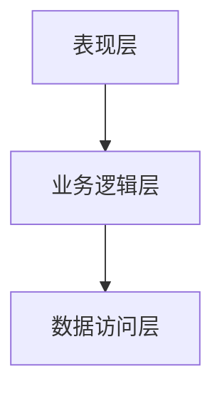
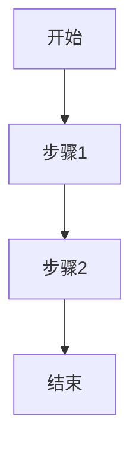
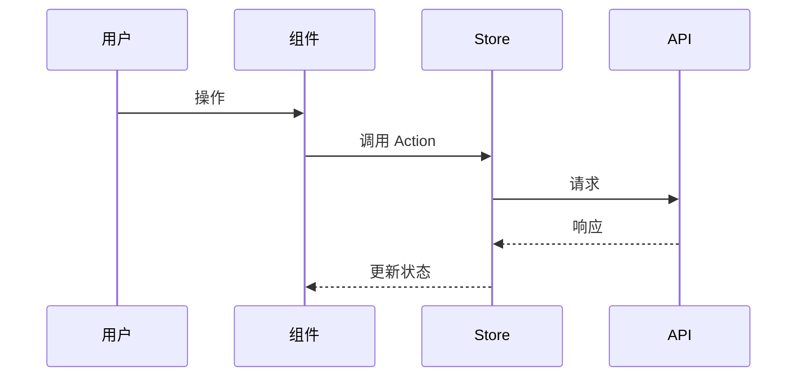
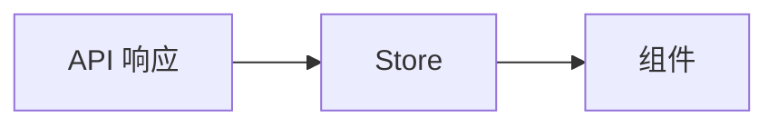

# 前端架构设计文档规范

> **最后更新**: 2025-11-26
> **适用范围**: Vue 3 + TypeScript 企业级项目

---

## 🚀 速查表

### 必须包含的 7 个章节

| 章节 | 核心内容 |
|------|----------|
| 一、需求与背景 | 业务背景、功能范围、用户角色、技术约束 |
| 二、架构设计 | 架构图、分层职责、模块划分 |
| 三、技术选型 | 技术栈总览、选型说明、风险评估 |
| 四、模块设计 | 目录结构、组件分类、核心组件接口 |
| 五、核心流程设计 | 流程总览、用户操作流程图、数据流时序图 |
| 六、数据设计 | 数据结构、Store 设计、数据流转 |
| 七、非功能性设计 | 性能优化、错误处理、安全风险（仅本模块特有） |

### 核心原则（7 条）

| 原则 | 说明 | 检查方式 |
|------|------|----------|
| **🤖 AI 前置校验** | 编写前必须执行 4 步校验 | 是否输出了校验报告？ |
| **聚焦技术方案** | 不含业务需求、UI 细节、编码规范 | 是否有 PRD 内容复制？ |
| **优先复用** | 先查 `src/components/` 和 `package.json` | 新依赖是否有充分理由？ |
| **表格描述** | 组件接口、数据结构、Store 用表格 | 是否有完整 TS 代码？ |
| **图文并茂** | 核心流程必须有 Mermaid 图 | 是否有用户流程 + 数据流？ |
| **聚焦本模块** | 非功能性设计只写本模块特有 | 是否写了全局配置？ |
| **标记变更** | 新增用 ⭐，修改用 🔧 | 目录结构是否标记？ |

### 输出格式速查

| 内容 | 格式 | 禁止 |
|------|------|------|
| 组件接口 | 表格：属性/事件、类型、说明 | 完整 TypeScript interface |
| 数据结构 | 表格：字段、类型、说明 | 完整 TypeScript type |
| Store 设计 | 表格：Store、职责、主要 Actions | 完整实现代码 |
| 用户操作流程 | Mermaid `graph TB` | 纯文字描述 |
| 组件间数据流 | Mermaid `sequenceDiagram` | 纯文字描述 |
| 状态流转 | Mermaid `stateDiagram-v2` | 纯文字描述 |

---

## 📋 文档定位

### 什么是前端架构设计文档？

前端架构设计文档是**技术方案设计阶段**的产出物，用于：
- 🎯 **指导开发**：为开发团队提供清晰的技术实现路径
- 🔍 **评审决策**：供架构师、技术负责人评审技术方案
- 📚 **知识沉淀**：记录技术选型和架构决策的原因
- 🔄 **后续迭代**：为后续功能扩展提供参考

### 与其他文档的区别

| 文档类型 | 关注点 | 目标读者 | 详细程度 |
|---------|-------|---------|---------|
| **PRD (产品需求文档)** | 业务需求、用户场景 | 产品、UI、开发 | 业务细节 |
| **前端架构设计** | 技术方案、系统设计 | 架构师、前端开发 | 技术细节 |
| **UI 设计规范** | 视觉样式、交互规范 | UI 设计师、前端开发 | UI 细节 |
| **API 接口文档** | 接口定义、数据结构 | 前后端开发 | 接口细节 |
| **开发规范文档** | 编码规范、最佳实践 | 所有开发者 | 规范细节 |

**核心原则**：架构设计文档应**聚焦技术方案**，不包含业务需求细节、UI 实现细节和编码规范。

### 适用场景

| 场景 | 是否适用 |
|------|----------|
| 新模块开发 | ✅ 适用 |
| 大版本重构 | ✅ 适用 |
| 技术方案评审 | ✅ 适用 |
| 小功能迭代 | ❌ 过于重量级 |

---

## 📚 标准章节结构

### 总体结构（7 个核心章节）

```markdown
# [模块名称] - 前端架构设计方案

## 📋 目录
[自动生成]

## 一、需求与背景
## 二、架构设计
## 三、技术选型
## 四、模块设计
## 五、核心流程设计
## 六、数据设计
## 七、非功能性设计
```

**说明**：所有模块架构设计文档必须包含这 7 个核心章节，不设置可选章节。

---

## 第一章：需求与背景

### 📋 章节目的
- 说明为什么需要这个模块
- 定义模块的边界和范围
- 明确技术约束和非功能性需求

### 📝 必需内容

- **1.1 业务背景**：业务目标、解决的问题、PRD 链接
- **1.2 功能范围**：核心功能列表、不包含的功能
- **1.3 用户角色与权限**：角色列表、权限范围、权限控制流程图
- **1.4 技术约束**：现有技术栈、必须遵守的规范、性能要求

---

## 第二章：架构设计

### 📋 章节目的
- 展示系统的整体架构
- 说明各层的职责和交互关系
- 定义技术边界

### 📝 必需内容

- **2.1 整体架构**：架构图（Mermaid）、架构说明（各层职责）
- **2.2 分层职责**：层级划分表（层级、职责、技术选型、示例）、边界规则
- **2.3 模块划分**：模块关系图（Mermaid）、模块说明表

**关键要求**：
- ✅ 必须包含架构图（使用 Mermaid `graph TB`）
- ✅ 明确各层的边界规则（如"表现层不直接调用 API"）

---

## 第三章：技术选型

### 📋 章节目的
- 说明关键技术的选择理由
- 对比不同方案的优劣
- 记录技术决策过程

### 📝 必需内容

- **3.1 技术栈总览**：技术领域、选型、版本、选择理由（表格形式）
- **3.2 关键技术说明**：针对本模块特有的技术需求，说明如何使用项目现有组件/库
- **3.3 技术风险评估**：技术、风险、风险等级、应对方案（表格形式）

**关键要求**：
- ✅ 选择理由要具体，避免"功能强大"等模糊描述
- ✅ 如需引入新技术，必须说明为什么现有方案不满足需求

---

## 第四章：模块设计

### 📋 章节目的
- 定义模块的目录结构
- 说明文件组织规范
- 展示组件分类原则

### 📝 必需内容

- **4.1 目录结构设计**：完整目录树（只列出新增和修改的部分，使用 ⭐ 和 🔧 标记）
- **4.2 组件分类规范**：分类原则图（Mermaid）、命名规范
- **4.3 核心组件设计**：仅列出关键的、复杂的组件，使用**表格描述**接口

**关键要求**：
- ✅ 目录结构必须使用 ⭐ 标记新增，🔧 标记修改
- ✅ 核心组件接口使用**表格形式**描述（不需要完整 TypeScript 代码）

---

## 第五章：核心流程设计

### 📋 章节目的
- 描述关键业务流程
- 展示组件间的交互
- 说明数据流动路径

### 📝 核心流程识别标准

**核心流程**必须满足以下条件**至少一条**：

| 判断标准 | 说明 |
|---------|------|
| 跨层级交互 | 涉及 2 个以上架构层的数据流动 |
| 异步状态同步 | 需要处理 Loading、Success、Error 三种状态 |
| 多分支决策 | 有 3 个以上的条件判断分支 |
| 关键业务路径 | 直接影响核心业务目标的流程 |
| 复杂数据流转 | 数据在 3 个以上组件/模块间传递 |

**非核心流程**（无需详细描述）：单层级操作、标准 CRUD、纯 UI 交互。

### 📝 必需内容

- **5.1 业务流程总览**：核心流程列表（1-3 句话说明每个流程）
- **5.2 单个流程设计**（每个核心流程一个小节）：
  - 流程概述（触发条件、参与组件、结束状态）
  - 用户操作流程（Mermaid `graph TB`）
  - 组件间数据流（Mermaid `sequenceDiagram`）
  - 异常处理（表格形式）

**关键要求**：
- ✅ 每个核心流程必须同时包含"用户操作流程"和"组件间数据流"两个视角
- ✅ 用户操作流程使用 `graph TB`，组件间数据流使用 `sequenceDiagram`

---

## 第六章：数据设计

### 📋 章节目的
- 定义前端数据结构
- 说明状态管理方案
- 展示数据流转路径

### 📝 必需内容

- **6.1 数据结构设计**：核心数据模型（使用**表格描述**字段）、数据来源说明
- **6.2 状态管理设计**：Store 划分图（Mermaid）、Store 职责说明（表格形式）
- **6.3 数据流转路径**：数据流转图（Mermaid）、关键说明

**关键要求**：
- ✅ 数据结构使用**表格形式**描述（不需要完整 TypeScript 代码）
- ✅ Store 设计说明职责和主要 Actions（不需要完整实现代码）

---

## 第七章：非功能性设计

### 📋 章节目的
- 说明**本模块特有的**性能优化方案
- 定义**本模块特有的**错误处理策略
- 识别**本模块特有的**安全风险

### 📝 必需内容

- **7.1 性能优化**：本模块的性能瓶颈和优化方案（如大数据量表格、文件上传、富文本编辑）
- **7.2 业务错误处理**：本模块特有的错误场景和处理方式（如文件格式错误、并发冲突）
- **7.3 安全风险**：本模块引入的安全风险和防护措施（如富文本 XSS、文件上传漏洞）

**关键要求**：
- ✅ **只关注本模块特有的非功能性需求**，不包含项目全局已有的配置
- ✅ 性能优化只列出本模块的性能瓶颈（如"竞赛列表 > 100 条需虚拟滚动"）
- ✅ 错误处理只列出业务错误（如"Excel 格式错误"），全局错误拦截器不需要
- ✅ 安全风险只列出本模块引入的新风险（如"富文本 XSS"），通用安全措施不需要

### ⚠️ 判断是否属于本模块的标准

| 问题类型 | 属于本模块（需要写） | 属于项目级（不需要写） |
|---------|---------------------|----------------------|
| **性能** | 本模块特有的大数据量场景（如列表 > 500 条） | 路由懒加载、图片懒加载（全局配置） |
| **性能** | 本模块特有的复杂计算（如实时图表渲染） | 组件缓存 keep-alive（全局配置） |
| **错误** | 业务逻辑错误（如 Excel 格式错误、数据冲突） | HTTP 错误码处理（Axios 拦截器） |
| **错误** | 本模块特有的校验失败（如文件大小超限） | Token 过期刷新（全局配置） |
| **安全** | 本模块引入的新攻击面（如富文本 XSS） | CSRF 防护（全局配置） |
| **安全** | 敏感数据处理（如导出用户隐私数据） | 请求签名、加密传输（全局配置） |

**判断流程**：
1. 问"这个问题是只有本模块才会遇到吗？"
2. 如果其他模块也有 → 检查项目是否已有全局方案
3. 如果项目已有全局方案 → 不需要写
4. 如果只有本模块才有 → 需要写

---

## 🤖 AI 前置校验机制

> **重要**：AI 在编写架构设计文档前，**必须先执行以下校验步骤**，避免臆造技术选型。

### 前置校验清单

| 步骤 | 校验内容 | 执行方式 | 必须/可选 |
|------|---------|---------|----------|
| 1️⃣ | 读取 `package.json` | `Read package.json` | **必须** |
| 2️⃣ | 扫描 `src/components/` | `Glob src/components/**/*.vue` | **必须** |
| 3️⃣ | 扫描 `src/api/generated/` | `ls src/api/generated/` | 可选（有 API 时） |
| 4️⃣ | 读取相关 API 接口文件 | `Read src/api/generated/[module]/[module].ts` | 可选（有 API 时） |

### 校验规则

**规则 1：禁止臆造依赖**
- 技术选型中的所有第三方库，必须在 `package.json` 中确认存在
- 版本号必须从 `package.json` 获取，不得猜测

**规则 2：优先复用现有组件**
- 编写"技术选型"章节前，必须先扫描 `src/components/` 目录
- 如有可复用组件，必须在文档中说明复用而非重新开发

**规则 3：API 接口需核实（如已存在）**
- 如果 API 已生成，编写"API 映射表"前必须读取实际 API 文件
- 如果 API 尚未生成，在文档中标注"待 API 生成后补充"

### 校验报告模板

AI 在编写架构文档前，应先输出简要校验报告：

```markdown
## 技术选型校验报告

### 1. package.json 依赖确认
- 富文本: @tiptap/vue-3 ✅
- 图表: echarts ✅
- PDF: pdfjs-dist ✅

### 2. 可复用全局组件
- RichTextEditor、PdfViewer、LazyImage、Skeleton/*

### 3. API 状态
- [已生成] / [待生成]
```

---

## 📊 质量检查清单

文档完成后必须逐项检查：

| 检查项 | 检查内容 |
|--------|----------|
| **前置校验** | 是否执行了校验并输出报告？ |
| **结构完整** | 包含第一到七章 |
| **图表完整** | 核心流程有 graph TB + sequenceDiagram |
| **技术选型** | 所有依赖是否在 `package.json` 中确认？ |
| **组件复用** | 是否检查了 `src/components/` 并优先复用？ |
| **表格描述** | 组件接口、数据结构用表格（无完整 TS 代码） |
| **聚焦本模块** | 非功能性设计无全局配置 |
| **目录标记** | 新增 ⭐，修改 🔧 |

---

## 📋 空白模板

> 复制以下模板开始编写新模块的架构设计文档

```markdown
# [模块名称] - 前端架构设计方案

> **版本**: v1.0
> **作者**: [作者]
> **日期**: [日期]
> **PRD**: [PRD 链接]

---

## 一、需求与背景

### 1.1 业务背景

[简述业务目标和解决的问题]

### 1.2 功能范围

**核心功能**：
- 功能 1
- 功能 2

**不包含**：
- 排除项 1

### 1.3 用户角色与权限

| 角色 | 权限范围 |
|------|----------|
| 管理员 | 全部功能 |
| 普通用户 | 查看 |

### 1.4 技术约束

- 约束 1
- 约束 2

---

## 二、架构设计

### 2.1 整体架构



### 2.2 分层职责

| 层级 | 职责 | 技术选型 |
|------|------|----------|
| 表现层 | UI 渲染 | Vue 组件 |
| 业务逻辑层 | 状态管理 | Pinia |
| 数据访问层 | API 调用 | Orval 生成 |

### 2.3 模块划分

| 模块 | 职责 |
|------|------|
| 模块 A | 职责描述 |

---

## 三、技术选型

### 3.1 技术栈总览

| 技术领域 | 选型 | 选择理由 |
|----------|------|----------|
| 状态管理 | Pinia | 项目已有配置 |

### 3.2 关键技术说明

[说明本模块特有的技术需求如何使用现有组件/库]

### 3.3 技术风险评估

| 风险 | 等级 | 应对方案 |
|------|------|----------|
| 风险 1 | 中 | 方案 1 |

---

## 四、模块设计

### 4.1 目录结构设计

```
src/
├── views/
│   └── [module-name]/           ⭐ 新增模块
│       ├── index.vue            ⭐ 列表页
│       └── components/          ⭐ 页面级组件
│           └── XxxForm.vue      ⭐ 表单组件
```

### 4.2 组件分类规范

| 分类 | 位置 | 说明 |
|------|------|------|
| 页面组件 | `views/[module]/` | 路由对应的页面 |
| 页面级组件 | `views/[module]/components/` | 本模块专属组件 |

### 4.3 核心组件设计

#### 组件名称

| 属性/事件 | 类型 | 说明 |
|----------|------|------|
| prop1 | `string` | 描述 |
| @event1 | `() => void` | 描述 |

---

## 五、核心流程设计

### 5.1 业务流程总览

| 流程 | 说明 |
|------|------|
| 流程 1 | 简述 |

### 5.2 [流程名称]

**触发条件**：[触发条件]
**参与组件**：[组件列表]
**结束状态**：[结束状态]

#### 用户操作流程



#### 组件间数据流



#### 异常处理

| 异常场景 | 处理方式 |
|---------|---------|
| 场景 1 | 处理 1 |

---

## 六、数据设计

### 6.1 数据结构设计

#### 数据模型名称

| 字段 | 类型 | 说明 |
|------|------|------|
| id | `string` | 唯一标识 |
| name | `string` | 名称 |

### 6.2 状态管理设计

| Store | 职责 | 主要 Actions |
|-------|------|--------------|
| XxxStore | 职责描述 | action1, action2 |

### 6.3 数据流转路径



---

## 七、非功能性设计

### 7.1 性能优化

| 场景 | 优化方案 |
|------|----------|
| [本模块特有的性能瓶颈] | [优化方案] |

### 7.2 业务错误处理

| 错误场景 | 处理方式 |
|---------|---------|
| [本模块特有的错误] | [处理方式] |

### 7.3 安全风险

| 风险 | 防护措施 |
|------|----------|
| [本模块引入的新风险] | [防护措施] |
```
